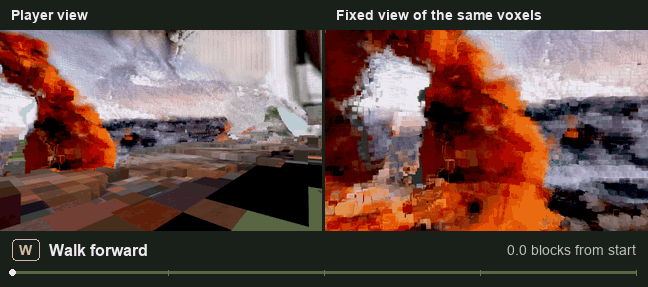
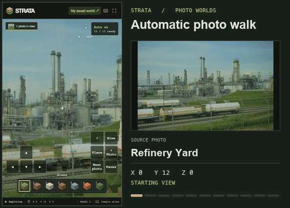
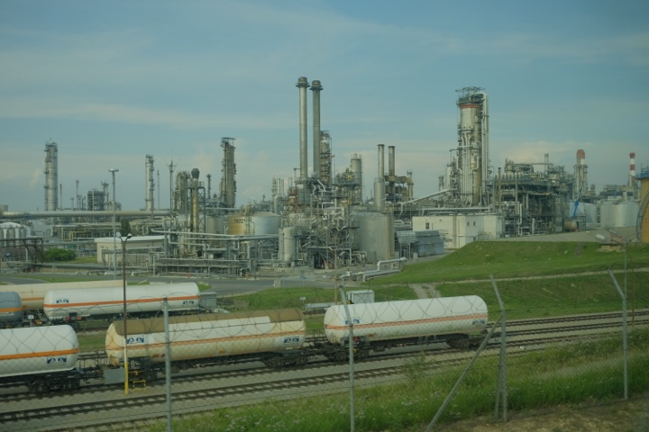
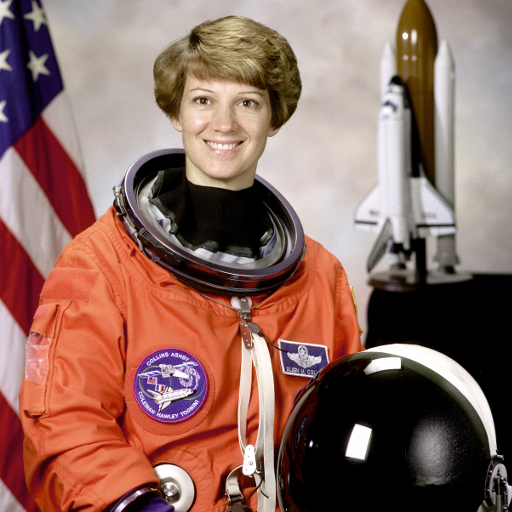
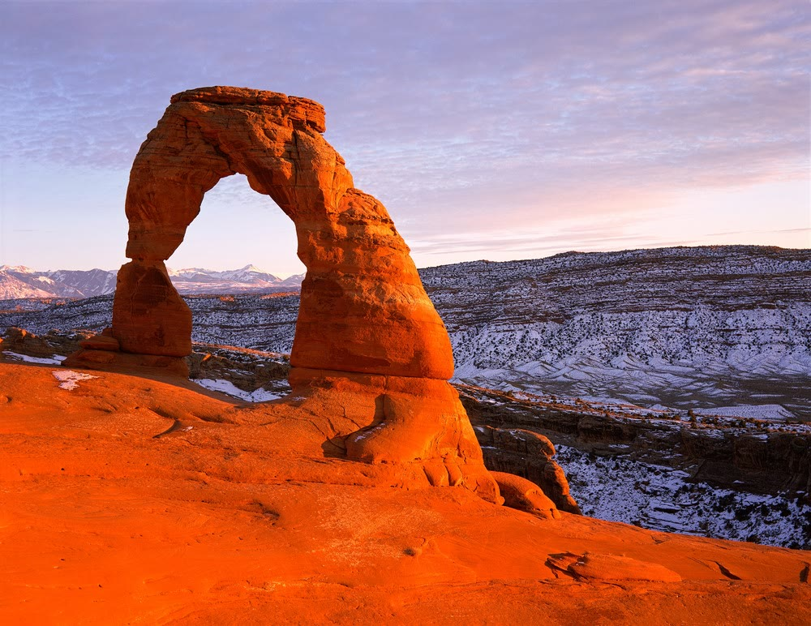
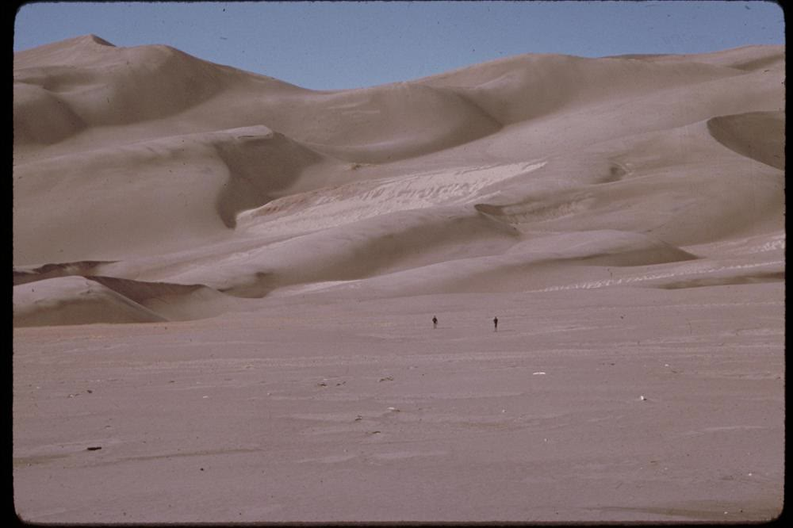
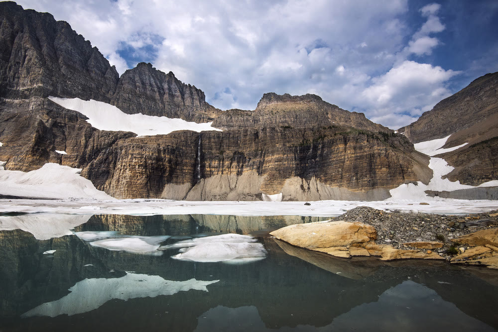
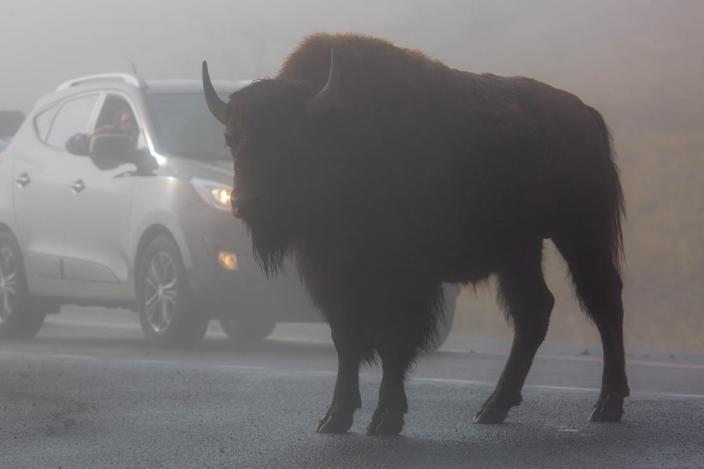
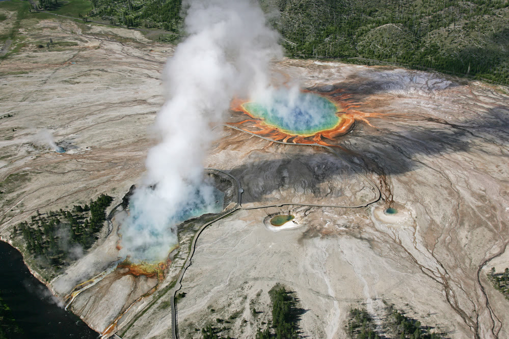

# Strata

[Play with your photos](https://jkubiniec.github.io/strata/) · [Try automatic placement on your phone](https://jkubiniec.github.io/strata/?demo=autowalk) · [Try the reversible morph](https://jkubiniec.github.io/strata/?demo=walk&complete=1&overlap=arch) · [Walk the 11-photo trail](https://jkubiniec.github.io/strata/?demo=walk)

Strata is a first-person browser game where you build a walkable voxel world from photographs. Start in a refinery, face its smokestacks and place a photo of a launchpad. The two scenes meet in the part of the sky you aimed at. Turn a little and add a third photo. You can walk through the overlap, look back at what you built, or mine a block and place one of your own.

## Eleven photos, one walk

All eleven photos are already in the world in the first GIF. Near Delicate Arch, the blocks take on more of the dunes’ shape and color as the player walks forward. Walking backward restores the earlier arrangement. The second camera stays in place so you can see which blocks actually move. [Try this exact overlap](https://jkubiniec.github.io/strata/?demo=walk&complete=1&overlap=arch)



Choose **Enter world**, hold **W** for about five seconds (23.8 blocks in the recording), then hold **S** to retrace your steps. Stop anywhere to hold the blend at that position. **Photo atlas** lets you return to any of the eleven captured views.

The next recording starts at the refinery and covers 224 blocks on foot. Another photograph joins the landscape at each waypoint. The thumbnail shows the source and the compass shows its placement angle. After the last photo, the player walks into open terrain. [Walk the trail from the beginning](https://jkubiniec.github.io/strata/?demo=walk)


## Place your own photos

1. Tap **Import & walk** on the phone entry screen and select several pictures in one visit to your library. This opens the world with automatic placement enabled. Strata prepares each picture on your device as you play. You can add more later through **Photo bank → Load photos**.
2. Hold the forward arrow to walk. Drag across the scene to turn. With **Place as I move** on, walking 12 blocks or turning 35° captures your view and places the next ready photo. Each new placement waits for the preceding blend to finish. The bank wraps around at the end. Standing still holds the current blend.
3. To revisit a finished overlap, switch **Auto** off and retrace your steps. The existing blocks still shift with your position. For manual placement, tap **Next photo** or press **B**. Your bank, cursor and placed views are saved in this browser.

The mobile sample starts in the refinery with eleven source photos in its bank. Point the camera where you want each part of the world to grow. [Walk with the sample bank](https://jkubiniec.github.io/strata/?demo=autowalk)

HEIC and JPEG photos can share a bank. If the browser cannot open an HEIC directly, Strata loads a local decoder and imports the primary still image. Your photos stay on your device.



The recording compresses 45 seconds of walking and turning. The right side shows the source photo and bearing captured at each placement. All twelve placements, including the first photo of the next cycle, came from movement.

Phones use smaller textures, fewer distant chunks and an adaptive drawing resolution. The refinery opens from precomputed depth and object features. A saved atlas rebuilds its overlapping views in batches. In a cold-cache comparison at a 390 × 664 iPhone viewport, the same eleven-photo scene opened in **7.68 seconds**, down from **21.69 seconds**. Median triangles per walking frame fell from **967,014 to 390,244** along the same route. These measurements used Chrome touch emulation on a Mac GPU. Physical iPhone results will vary.

**U** still opens the picker for a single photograph. **Replay placement** repeats the arrival of the newest image. Walking through an established overlap controls the blend directly through your position.

For a smaller experiment, **Try overlapping views** opens the refinery, launchpad and astronaut portrait captured at 0°, 22° and 46° from the same spot. [Open the three-photo example](https://jkubiniec.github.io/strata/?demo=views)

## The photo atlas

These are the source photographs in walking order. Under each image are its horizontal position in blocks, compass bearing and camera pitch. The refinery is the origin. North is 0° and east is 90°.

| | | |
| --- | --- | --- |
| <br>**01 · Refinery Yard**<br>X 0, Z 0 · 0° · +0°<br>CAM15071.JPG · supplied refinery photo | <br>**02 · Launch Pad**<br>X 7, Z -5 · 28° · +2°<br>[SpaceX](https://scikit-image.org/docs/stable/api/skimage.data.html#skimage.data.rocket) | <br>**03 · Eileen Collins**<br>X 18, Z -6 · 62° · +0°<br>[NASA](https://scikit-image.org/docs/stable/api/skimage.data.html#skimage.data.astronaut) |
| <br>**04 · Delicate Arch**<br>X 34, Z 0 · 27° · -2°<br>[NPS / Neal Herbert](https://npgallery.nps.gov/AssetDetail/26804909-155d-451f-671d-047b2f70d54b) | <br>**05 · Great Sand Dunes**<br>X 51, Z 6 · 2° · +2°<br>[NPS staff](https://npgallery.nps.gov/AssetDetail/0225cfa4-0f71-444d-8d50-bb79fc4257cb) | <br>**06 · Grinnell Glacier Basin**<br>X 70, Z 9 · 30° · -4°<br>[NPS / Tim Rains](https://npgallery.nps.gov/AssetDetail/34F574D2-1DD8-B71B-0BDE3EA69DD198E8) |
| <br>**07 · Geyser Boardwalk**<br>X 89, Z 6 · 12° · -1°<br>[NPS / Jim Peaco](https://npgallery.nps.gov/AssetDetail/8ecfa1e0-9fd7-4ae5-b9b5-98d35fe84033) | <br>**08 · Redwood Canopy**<br>X 111, Z 4 · 35° · +6°<br>[NPS Gallery](https://npgallery.nps.gov/AssetDetail/fbcf44ce-0a69-45cc-9987-62dbf7724677) | <br>**09 · Bison in the Fog**<br>X 130, Z 11 · 356° · -2°<br>[NPS / Neal Herbert](https://npgallery.nps.gov/AssetDetail/915b53b9-878e-44c1-a224-6455e451f9af) |
| <br>**10 · Grand Prismatic Spring**<br>X 148, Z 17 · 25° · -7°<br>[NPS / Jim Peaco](https://npgallery.nps.gov/AssetDetail/3CD0B5E3-1DD8-B71B-0B6581AD308BC259) | <br>**11 · Glacier Aurora**<br>X 169, Z 22 · 5° · +3°<br>[NPS](https://npgallery.nps.gov/AssetDetail/0D18DAD7-1DD8-B71B-0BA2394F5A8D3FF8) |  |

## How a photo becomes a landscape

Each placement records the camera position, direction and field of view. The photo is cropped to fill that frame. Depth Anything V2 Small estimates how near each visible surface is. Tiny YOLOv3 detects familiar objects and supplies visual features for matching patches across photos. Strata projects color and depth samples along camera rays to place those surfaces in world coordinates. Higher-resolution inputs receive a larger detail budget. The saved source texture has a 1,280-pixel long edge limit on phones and a 3,072-pixel limit on desktop. The original stays in your library. [Depth Anything V2](https://depth-anything-v2.github.io/) · [Darknet YOLO](https://pjreddie.com/darknet/yolo/)

Where camera views intersect, all contributing photos influence the shared geometry. Matches between image features help shift corresponding details. Nearer observations and the centers of captured views receive more weight when blending depth and color. As a placement arrives, cube centers move into their new arrangement while their faces stay aligned with the world axes. The visual reference is the kind of image transformation seen in CycleGAN and StyleGAN. Strata computes its morph from feature correspondences, estimated depths and shared 3D positions. Each matched region retains possible positions and colors from the photos that see it. On every moving frame, the player’s distance to the capture viewpoints changes their relative influence, shifting the block centers and Gaussian splats toward the nearer photo. Returning to the same position gives the same blend. Photos taken from one spot also respond to walking along their sight lines. Geometry within building reach stays aligned with the collision grid for mining and placement. **Voxels** shows the block geometry, **Splats** shows the soft Gaussian footprints that carry finer color detail, and **Hybrid** draws both. [CycleGAN research](https://junyanz.github.io/CycleGAN/)

A single image leaves the backs of objects and their absolute distances unknown. Strata estimates thickness and extends terrain procedurally. Moving far from the capture view can reveal those approximations, and unrelated images can produce ghosted features in their overlap. For two research approaches to generating unseen parts of a scene, see [WonderWorld](https://arxiv.org/abs/2406.09394) and [Complete Gaussian Splats](https://nianticspatial.github.io/completesplat/).

The terrain continues beyond every photo. As you walk, Strata builds 16 × 16-block chunks around your position and retires distant meshes. Returning to the same coordinates regenerates the same ground and restores your block edits. Each photo stays anchored where you placed it, so you can walk back to a familiar scene or keep extending your world with new photos.

## Where to take the world next

- **Give landmarks a second angle.** Photograph a doorway or the refinery stacks from two sides. An optional multi-view reconstruction pass could estimate the cameras and register the shared surfaces before voxelizing them. That would give a doorway real thickness when you walk through it and keep a stack in one place when you circle it. [VGGT](https://vgg-t.github.io/)
- **Choose what a morph should preserve.** Let the player tap the arch in one photo and the doorway in the next. Use those two masks to guide the existing depth and color morph. That would make the opening stay recognizable throughout the transition, even when the photos depict different places.
- **Generate the view behind a single photo.** An optional desktop processing pass could propose several plausible hidden sides of an object, let the player keep one, then bake it into a compact voxel and splat tile for the phone. A generated back is a creative choice the player can revisit. [Complete Gaussian Splats](https://nianticspatial.github.io/completesplat/)

## Run locally

From the project root, serve the bundled app with Python 3 and open it in a WebGL 2 browser. On macOS you can also double-click **Play Strata.command**.

```sh
python3 -m http.server 8741 --bind 127.0.0.1 --directory dist
```

Once the server is running, open [the local game](http://127.0.0.1:8741/). Photo analysis runs on your device. Images, placements, player position and block edits are saved in this browser’s IndexedDB. Browser storage quota and device memory determine how many photos a world can hold.

| Action | Controls |
| --- | --- |
| Walk, sprint, jump | WASD, Shift, Space |
| Look around | Mouse or I/J/K/L |
| Fly, rise, descend | F or double-tap Space to toggle flight, then Space / Q |
| Mine, place | Left / right mouse button or E / R |
| Choose material | 1–7 or mouse wheel |
| Place the next ready photo from the bank | B |
| Pick a single photo, release the pointer | U, Esc |

Touch controls are also available. To run the geometry and correspondence tests, use Node.js 22 or later.

```sh
node --test tests/*.test.mjs
```

## Research and credits

The soft rendering layer draws on 3D Gaussian Splatting. Flash3D and SHARP informed how Strata lifts a photograph into depth and preserves its appearance near the source camera. Deep Image Analogy informs cross-image feature matching. [3D Gaussian Splatting](https://repo-sam.inria.fr/fungraph/3d-gaussian-splatting/) · [Flash3D](https://www.robots.ox.ac.uk/~vgg/research/flash3d/) · [SHARP](https://apple-aiml-research.github.io/ml-sharp/) · [Deep Image Analogy](https://arxiv.org/abs/1705.01088)

The starter world uses the supplied refinery photograph `CAM15071.JPG`. The example also uses a SpaceX launch photograph and NASA’s portrait of astronaut Eileen Collins, both distributed by scikit-image. [SpaceX photo credit](https://scikit-image.org/docs/stable/api/skimage.data.html#skimage.data.rocket) · [NASA photo credit](https://scikit-image.org/docs/stable/api/skimage.data.html#skimage.data.astronaut)

Model provenance and bundled runtime licenses are included with the app. [Vision model notices](dist/vendor/vision/NOTICE.txt) · [HEIC decoder notices and corresponding source](dist/vendor/heif/NOTICE.txt) · [Three.js license](dist/vendor/THREE-LICENSE.txt)
