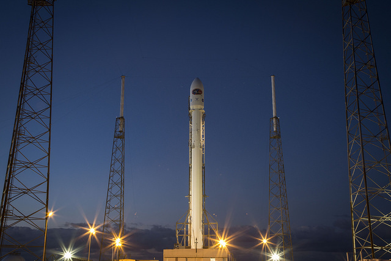
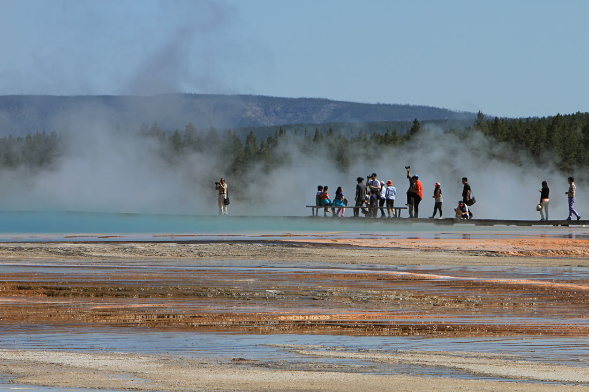
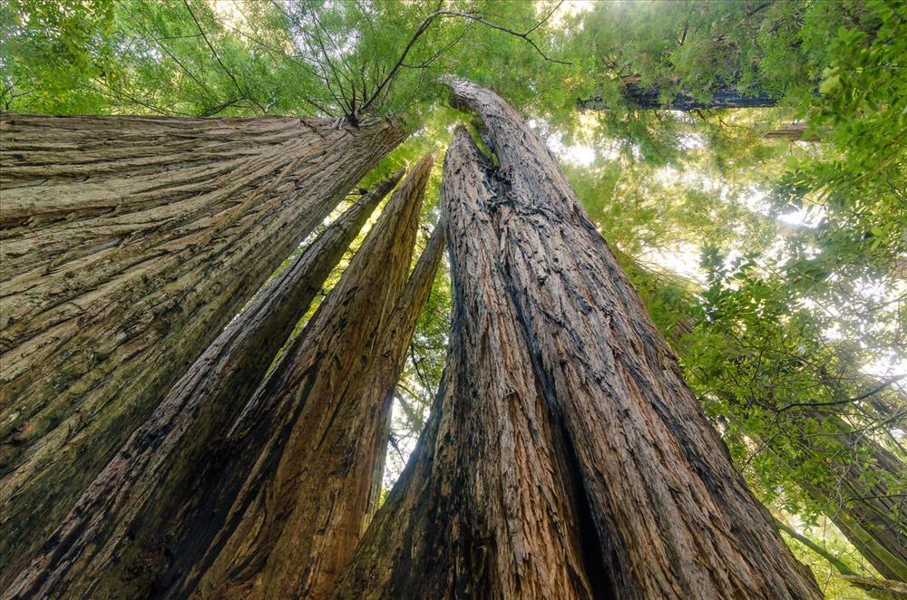
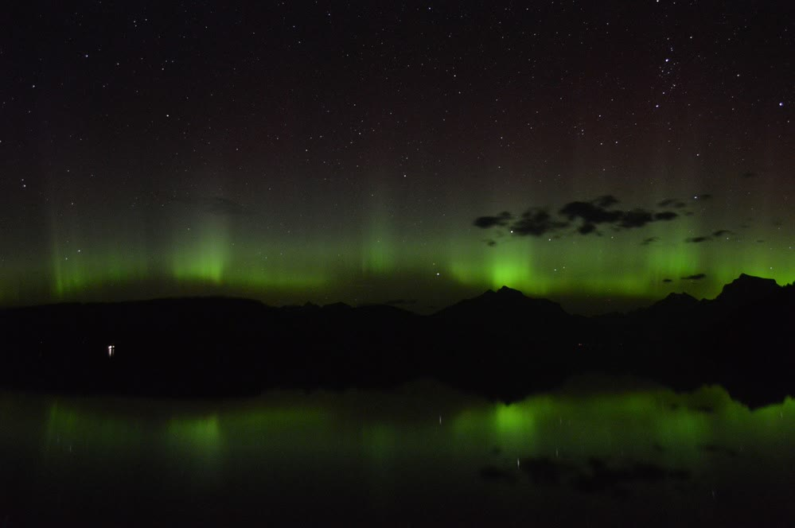

# Strata

[Play Strata](https://jkubiniec.github.io/strata/) · [Walk the 11-photo trail](https://jkubiniec.github.io/strata/?demo=walk) · [Explore all 11 placements](https://jkubiniec.github.io/strata/?demo=walk&complete=1)

Strata is a first-person browser game where you build a walkable voxel world from photographs. Start in a refinery, face its smokestacks and place a photo of a launchpad. The two scenes meet in the part of the sky you aimed at. Turn a little and add a third photo. You can walk through the overlap, look back at what you built, or mine a block and place one of your own.

## Eleven photos, one walk

Start at the refinery and head toward the first waypoint. As you approach each stop, another photograph takes shape in front of its recorded camera. Watch how the rocket, portrait and sandstone arch occupy some of the same space. A few steps sideways separate the nearest blocks from the skyline. [Walk the route in your browser](https://jkubiniec.github.io/strata/?demo=walk)


The first recording covers 224 blocks on foot. The thumbnail identifies the arriving photograph, and the compass shows which way the player was facing when they placed it.

The second recording follows one continuous, 262-block walk. Each new image morphs into place as the player walks about nine blocks. The path carries on past the aurora into open terrain. The finished atlas lets you revisit all eleven camera positions. [Enter the finished world](https://jkubiniec.github.io/strata/?demo=walk&complete=1)


## Place your own photos

1. Choose **Enter world**, then aim with the mouse. Press **U** or choose **Add photo here** and pick one image. Strata remembers exactly where you were looking when you opened the picker.
2. From the same spot, turn about 20° and place a second image. Watch where the two views meet. **Replay placement** repeats the latest transition, including when viewed from a different angle.
3. Hold **W** and walk toward a recognizable feature. Sidestep with **A** or **D** and watch nearby blocks shift against the distant skyline. Keep walking past the photo and place the next image from wherever you arrive. **Photo atlas** lets you return to any image’s original viewpoint.

For a smaller experiment, **Try overlapping views** opens the refinery, launchpad and astronaut portrait captured at 0°, 22° and 46° from the same spot. [Open the three-photo example](https://jkubiniec.github.io/strata/?demo=views)

## The photo atlas

These are the source photographs in walking order. Under each image are its horizontal position in blocks, compass bearing and camera pitch. The refinery is the origin. North is 0° and east is 90°.

| | | |
| --- | --- | --- |
| <br>**01 · Refinery Yard**<br>X 0, Z 0 · 0° · +0°<br>CAM15071.JPG · supplied refinery photo | <br>**02 · Launch Pad**<br>X 7, Z -5 · 28° · +2°<br>[SpaceX](https://scikit-image.org/docs/stable/api/skimage.data.html#skimage.data.rocket) | <br>**03 · Eileen Collins**<br>X 18, Z -6 · 62° · +0°<br>[NASA](https://scikit-image.org/docs/stable/api/skimage.data.html#skimage.data.astronaut) |
| <br>**04 · Delicate Arch**<br>X 34, Z 0 · 27° · -2°<br>[NPS / Neal Herbert](https://npgallery.nps.gov/AssetDetail/26804909-155d-451f-671d-047b2f70d54b) | <br>**05 · Great Sand Dunes**<br>X 51, Z 6 · 2° · +2°<br>[NPS staff](https://npgallery.nps.gov/AssetDetail/0225cfa4-0f71-444d-8d50-bb79fc4257cb) | <br>**06 · Grinnell Glacier Basin**<br>X 70, Z 9 · 30° · -4°<br>[NPS / Tim Rains](https://npgallery.nps.gov/AssetDetail/34F574D2-1DD8-B71B-0BDE3EA69DD198E8) |
| <br>**07 · Geyser Boardwalk**<br>X 89, Z 6 · 12° · -1°<br>[NPS / Jim Peaco](https://npgallery.nps.gov/AssetDetail/8ecfa1e0-9fd7-4ae5-b9b5-98d35fe84033) | <br>**08 · Redwood Canopy**<br>X 111, Z 4 · 35° · +6°<br>[NPS Gallery](https://npgallery.nps.gov/AssetDetail/fbcf44ce-0a69-45cc-9987-62dbf7724677) | <br>**09 · Bison in the Fog**<br>X 130, Z 11 · 356° · -2°<br>[NPS / Neal Herbert](https://npgallery.nps.gov/AssetDetail/915b53b9-878e-44c1-a224-6455e451f9af) |
| <br>**10 · Grand Prismatic Spring**<br>X 148, Z 17 · 25° · -7°<br>[NPS / Jim Peaco](https://npgallery.nps.gov/AssetDetail/3CD0B5E3-1DD8-B71B-0B6581AD308BC259) | <br>**11 · Glacier Aurora**<br>X 169, Z 22 · 5° · +3°<br>[NPS](https://npgallery.nps.gov/AssetDetail/0D18DAD7-1DD8-B71B-0BA2394F5A8D3FF8) |  |

## How a photo becomes a landscape

Each placement records the camera position, direction and field of view. The photo is cropped to fill that frame. Depth Anything V2 Small estimates how near each visible surface is. Tiny YOLOv3 detects familiar objects and supplies visual features for matching patches across photos. Strata projects color and depth samples along camera rays to place those surfaces in world coordinates. Higher-resolution inputs receive a larger detail budget, with source textures capped at 3,072 pixels on the long edge. [Depth Anything V2](https://depth-anything-v2.github.io/) · [Darknet YOLO](https://pjreddie.com/darknet/yolo/)

Where camera views intersect, all contributing photos influence the shared geometry. Matches between image features help shift corresponding details. Nearer observations and the centers of captured views receive more weight when blending depth and color. As a placement arrives, cube centers move into their new arrangement while their faces stay aligned with the world axes. The visual reference is the kind of image transformation seen in CycleGAN and StyleGAN. Strata computes its morph from feature correspondences, estimated depths and shared 3D positions. A new placement animates those positions. Walking changes which parts of that blend you can see, revealing parallax and occlusion. **Voxels** shows the block geometry, **Splats** shows the soft Gaussian footprints that carry finer color detail, and **Hybrid** draws both. [CycleGAN research](https://junyanz.github.io/CycleGAN/)

A single image leaves the backs of objects and their absolute distances unknown. Strata estimates thickness and extends terrain procedurally. Moving far from the capture view can reveal those approximations, and unrelated images can produce ghosted features in their overlap. For two research approaches to generating unseen parts of a scene, see [WonderWorld](https://arxiv.org/abs/2406.09394) and [Complete Gaussian Splats](https://nianticspatial.github.io/completesplat/).

The terrain continues beyond every photo. As you walk, Strata builds 16 × 16-block chunks around your position and retires distant meshes. Returning to the same coordinates regenerates the same ground and restores your block edits. Each photo stays anchored where you placed it, so you can walk back to a familiar scene or keep extending your world with new photos.

## Run locally

From the project root, serve the bundled app with Python 3 and open it in a WebGL 2 browser. On macOS you can also double-click **Play Strata.command**.

```sh
python3 -m http.server 8741 --bind 127.0.0.1 --directory dist
```

Once the server is running, open [the local game](http://127.0.0.1:8741/). Photo analysis runs on your device. Images, placements, player position and block edits are saved in this browser’s IndexedDB. Browser storage quota and device memory determine how many photos a world can hold.

| Action | Controls |
| --- | --- |
| Walk, sprint, jump | WASD, Shift, Space |
| Look around | Mouse or I/J/K/L |
| Fly, rise, descend | F or double-tap Space to toggle flight, then Space / Q |
| Mine, place | Left / right mouse button or E / R |
| Choose material | 1–7 or mouse wheel |
| Place a photo, release the pointer | U, Esc |

Touch controls are also available. To run the geometry and correspondence tests, use Node.js 22 or later.

```sh
node --test tests/*.test.mjs
```

## Research and credits

The soft rendering layer draws on 3D Gaussian Splatting. Flash3D and SHARP informed how Strata lifts a photograph into depth and preserves its appearance near the source camera. Deep Image Analogy informs cross-image feature matching. [3D Gaussian Splatting](https://repo-sam.inria.fr/fungraph/3d-gaussian-splatting/) · [Flash3D](https://www.robots.ox.ac.uk/~vgg/research/flash3d/) · [SHARP](https://apple-aiml-research.github.io/ml-sharp/) · [Deep Image Analogy](https://arxiv.org/abs/1705.01088)

The starter world uses the supplied refinery photograph `CAM15071.JPG`. The example also uses a SpaceX launch photograph and NASA’s portrait of astronaut Eileen Collins, both distributed by scikit-image. [SpaceX photo credit](https://scikit-image.org/docs/stable/api/skimage.data.html#skimage.data.rocket) · [NASA photo credit](https://scikit-image.org/docs/stable/api/skimage.data.html#skimage.data.astronaut)

Model provenance and bundled runtime licenses are included with the app. [Vision model notices](dist/vendor/vision/NOTICE.txt) · [Three.js license](dist/vendor/THREE-LICENSE.txt)
