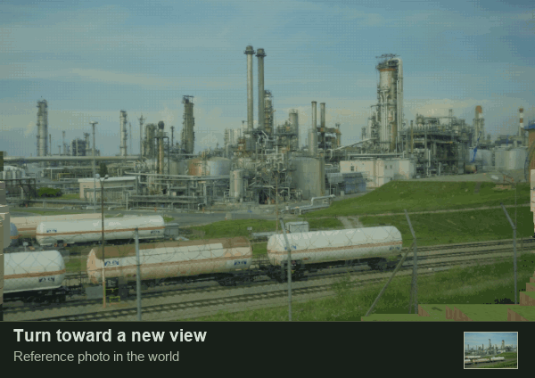

# Strata

[Play Strata](https://jkubiniec.github.io/strata/) · [Explore the three-photo demo](https://jkubiniec.github.io/strata/?demo=views)

Strata is a first-person browser game where you build a walkable voxel world from photographs. Start in a refinery, face its smokestacks and place a photo of a launchpad. The two scenes meet in the part of the sky you aimed at. Turn a little and add a third photo. You can walk through the overlap, look back at what you built, or mine a block and place one of your own.



## Try the morph

1. Choose **Enter world**, then aim with the mouse. Press **U** or choose **Add photo here** and pick one image. Strata remembers exactly where you were looking when you opened the picker.
2. From the same spot, turn about 20° and place a second image. Watch where the two views meet. **Replay placement** repeats the latest transition, including when viewed from a different angle.
3. Turn again and add another photo, or walk somewhere new before placing it. Open **Photo atlas** and select an image to return to its original viewpoint.

**Try overlapping views** opens a separate example world with the refinery, launchpad and astronaut portrait placed at 0°, 22° and 46° from the same spot.


## How a photo becomes a landscape

Each placement records the camera position, direction and field of view. The photo is cropped to fill that frame. Depth Anything V2 Small estimates how near each visible surface is. Tiny YOLOv3 detects familiar objects and supplies visual features for matching patches across photos. Strata projects color and depth samples along camera rays to place those surfaces in world coordinates. Higher-resolution inputs receive a larger detail budget, with source textures capped at 3,072 pixels on the long edge. [Depth Anything V2](https://depth-anything-v2.github.io/) · [Darknet YOLO](https://pjreddie.com/darknet/yolo/)

Where camera views intersect, all contributing photos influence the shared geometry. Matches between image features help shift corresponding details. Local weights blend their depth and color. As a placement arrives, cube centers move into their new arrangement while their faces stay aligned with the world axes. The visual reference is a walk through StyleGAN’s latent space. Here the motion comes from interpolating the positions of matched image features. **Voxels** shows the block geometry, **Splats** shows the soft Gaussian footprints that carry finer color detail, and **Hybrid** draws both.

A single image leaves the backs of objects and their absolute distances unknown. Strata estimates thickness and extends terrain procedurally. Moving far from the capture view can reveal those approximations, and unrelated images can produce ghosted features in their overlap. For two research approaches to generating unseen parts of a scene, see [WonderWorld](https://arxiv.org/abs/2406.09394) and [Complete Gaussian Splats](https://nianticspatial.github.io/completesplat/).

## Run locally

From the project root, serve the bundled app with Python 3 and open it in a WebGL 2 browser. On macOS you can also double-click **Play Strata.command**.

```sh
python3 -m http.server 8741 --bind 127.0.0.1 --directory dist
```

Once the server is running, open [the local game](http://127.0.0.1:8741/). Photo analysis runs on your device. Images, placements, player position and block edits are saved in this browser’s IndexedDB. Browser storage quota and device memory determine how many photos a world can hold.

| Action | Controls |
| --- | --- |
| Walk, sprint, jump | WASD, Shift, Space |
| Look around | Mouse or I/J/K/L |
| Fly, rise, descend | F or double-tap Space to toggle flight, then Space / Q |
| Mine, place | Left / right mouse button or E / R |
| Choose material | 1–7 or mouse wheel |
| Place a photo, release the pointer | U, Esc |

Touch controls are also available. To run the geometry and correspondence tests, use Node.js 22 or later.

```sh
node --test tests/*.test.mjs
```

## Research and credits

The soft rendering layer draws on 3D Gaussian Splatting. Flash3D and SHARP informed how Strata lifts a photograph into depth and preserves its appearance near the source camera. Deep Image Analogy informs cross-image feature matching. [3D Gaussian Splatting](https://repo-sam.inria.fr/fungraph/3d-gaussian-splatting/) · [Flash3D](https://www.robots.ox.ac.uk/~vgg/research/flash3d/) · [SHARP](https://apple-aiml-research.github.io/ml-sharp/) · [Deep Image Analogy](https://arxiv.org/abs/1705.01088)

The starter world uses the supplied refinery photograph `CAM15071.JPG`. The example also uses a SpaceX launch photograph and NASA’s portrait of astronaut Eileen Collins, both distributed by scikit-image. [SpaceX photo credit](https://scikit-image.org/docs/stable/api/skimage.data.html#skimage.data.rocket) · [NASA photo credit](https://scikit-image.org/docs/stable/api/skimage.data.html#skimage.data.astronaut)

Model provenance and bundled runtime licenses are included with the app. [Vision model notices](dist/vendor/vision/NOTICE.txt) · [Three.js license](dist/vendor/THREE-LICENSE.txt)
