# Strata

Walk into a photograph, turn a few degrees, and place another one. Where the two camera views overlap, the blocks shift toward the nearer photo as you walk. Step back and they return. A placed film keeps moving even when you stand still.

| [Play the computer demo](https://jkubiniec.github.io/strata/?demo=computer) | [Play the phone demo](https://jkubiniec.github.io/strata/?demo=phone) |
| --- | --- |
| Mouse look, keyboard movement and a larger rendering budget | Touch movement and aiming in portrait or landscape, with adaptive resolution |

Both arcade demos draw from **69 historical images**. One visit might take you from an eruption above the Bay of Naples to a snowbound Colorado railway. The in-game **Historical atlas** gives the date, caption, credit and original collection record for every image. The public worlds start fresh and never open the browser’s personal media database. To import your own photos and videos, enter **My media world**. [Browse all 69 sources](docs/historical-atlas.md) · [Open My media world](https://jkubiniec.github.io/strata/?world=mine)

## Fly around a playing film

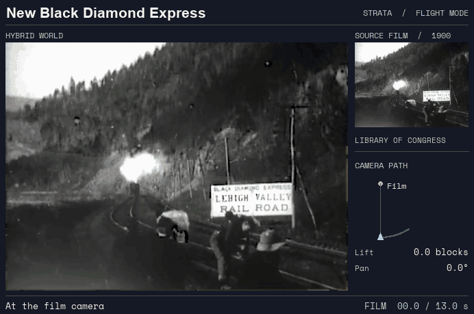

The locomotive first appears head-on. The player flies 26 blocks to the right and climbs 10, turning to keep the train in view. Watch the railroad sign shift against the distant trees. The smaller panel shows the same instant in the original film. The film is *New Black Diamond Express*, recorded by the Edison Manufacturing Co. in 1900. [Enter the train scene](https://jkubiniec.github.io/strata/?demo=video) · [Library of Congress film record](https://www.loc.gov/item/00694259/)

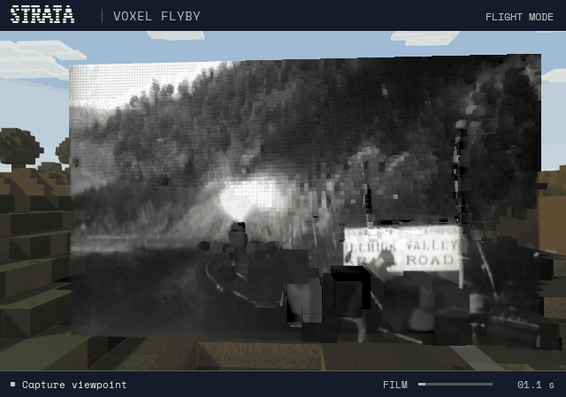

The close pass goes left and climbs nearly seven blocks. For the last four seconds, the camera hovers at the same spot. Watch the white steam spread across the square faces as the locomotive advances underneath it.

To try it on a computer, choose **Enter world** and press **F** to fly. Hold **D** to move sideways and **Space** to climb, then turn the mouse back toward the locomotive. Choose **Voxels** in the inspector to see the individual blocks. **Pause video** freezes the film at the current frame so you can fly around that instant.

## Walk through the atlas

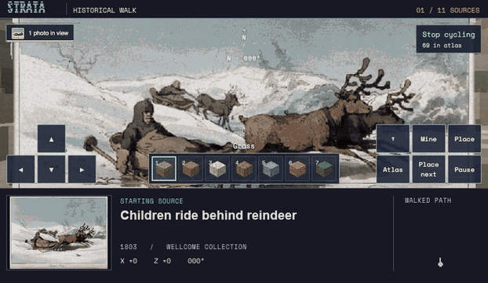

Walking 12 blocks or turning 35° places the next ready image inside the current camera view. A quick turn can leave two images sharing the same stretch of ground. The bank wraps around, and the world streams more terrain as you walk beyond the images. The GIF replays the camera path of a 307-block phone walk in the game renderer. It pauses briefly at each of the eleven measured capture points so you can compare the historical image with its surroundings. [Play the recorded phone deck](https://jkubiniec.github.io/strata/?demo=phone&seed=historywalk)

<details>
<summary>See the eleven source images, capture positions and compass bearings</summary>

| | | |
| --- | --- | --- |
| 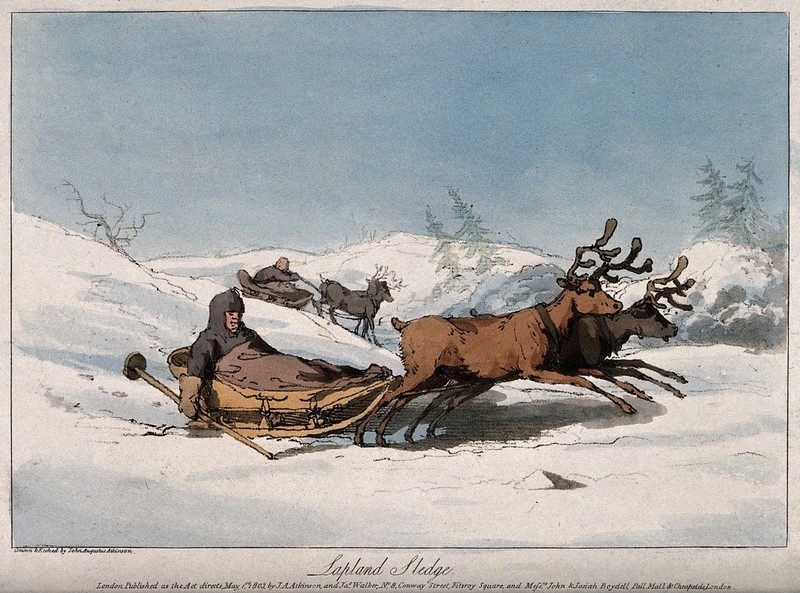<br>**01 · Children ride behind reindeer**<br>X 0.0, Z 0.0 · 0°<br>[1803 collection record](https://wellcomecollection.org/works/wqck7jnd) | 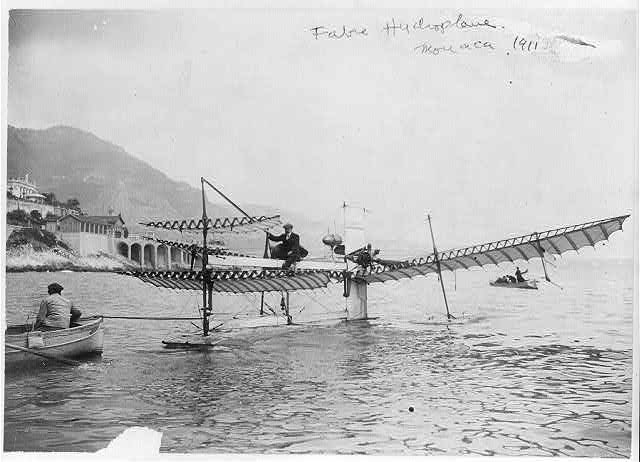<br>**02 · Fabre's Hydroplane at Monaco**<br>X 2.2, Z -12.0 · 12°<br>[1911 collection record](https://www.loc.gov/pictures/collection/ggbain/item/2002722170/) | 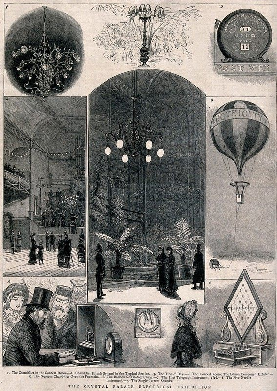<br>**03 · The Crystal Palace switches on**<br>X 6.2, Z -37.0 · 356°<br>[1882 collection record](https://wellcomecollection.org/works/pvwzyswy) |
| 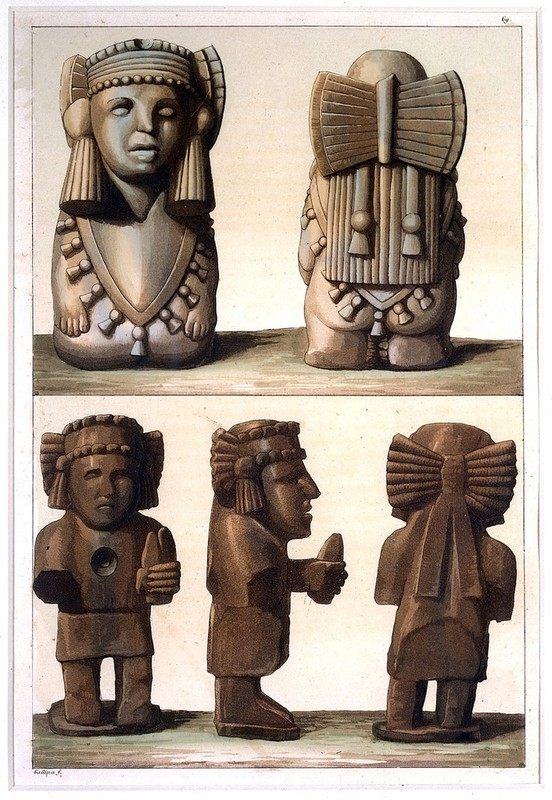<br>**04 · A basalt figure follows Humboldt**<br>X 2.9, Z -53.6 · 6°<br>[c. 1820 collection record](https://wellcomecollection.org/works/uagvw2g9) | 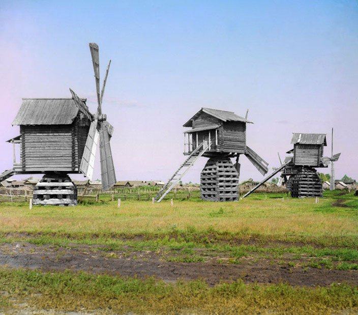<br>**05 · Windmills of Ialutorovsk**<br>X 7.9, Z -71.7 · 1°<br>[1912 collection record](https://www.loc.gov/pictures/item/prk2000002370/) | 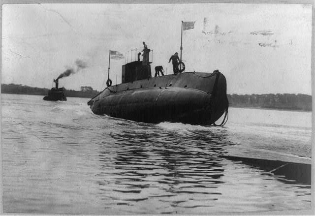<br>**06 · The Snapper at Its Launch**<br>X 11.4, Z -60.4 · 340°<br>[1909 collection record](https://www.loc.gov/pictures/collection/ggbain/item/97505681/) |
| 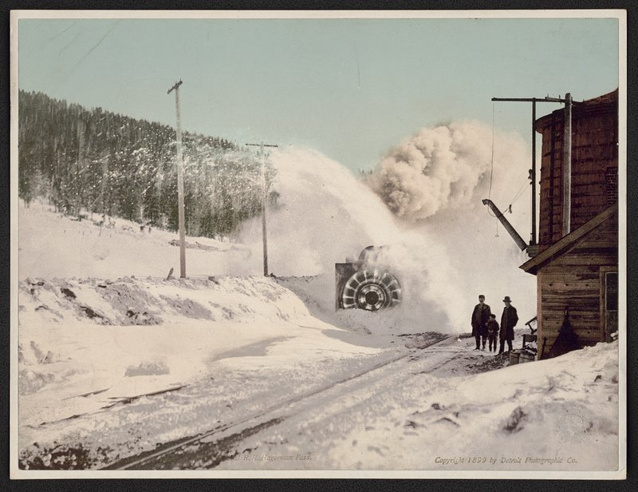<br>**07 · Snowplow at Hagerman Pass**<br>X 3.2, Z -77.8 · 347°<br>[1899 collection record](https://www.loc.gov/pictures/collection/det/item/2017658705/) | 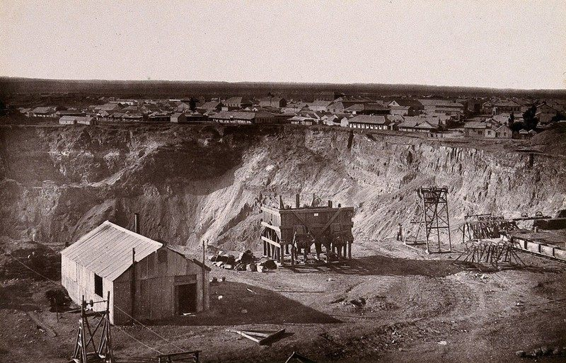<br>**08 · A town at the lip of a diamond mine**<br>X 1.7, Z -79.6 · 24°<br>[1888 collection record](https://wellcomecollection.org/works/se7u4njm) | 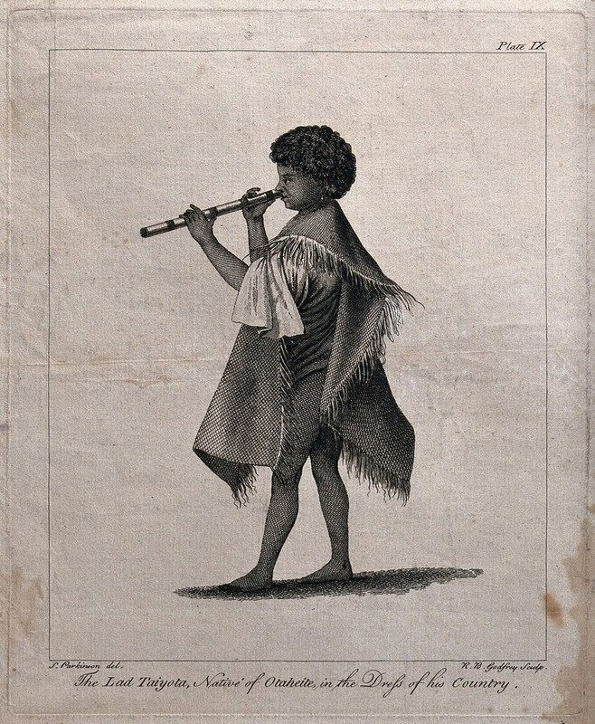<br>**09 · Taiyota plays the nose flute**<br>X 0.3, Z -71.3 · 61°<br>[1773 collection record](https://wellcomecollection.org/works/p4sxamvm) |
| 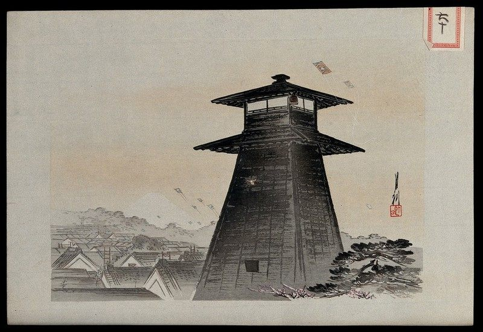<br>**10 · Spring kites over old Edo**<br>X 10.6, Z -75.3 · 7°<br>[Early 20th century collection record](https://wellcomecollection.org/works/jz87d5a5) | 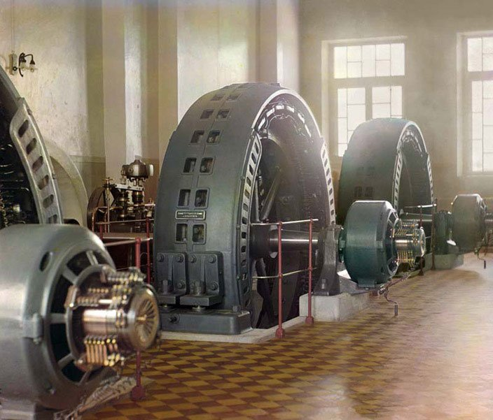<br>**11 · The Generator Hall**<br>X -12.4, Z -21.2 · 21°<br>[c. 1907–1915 collection record](https://www.loc.gov/pictures/item/prk2000002476/) |  |

</details>

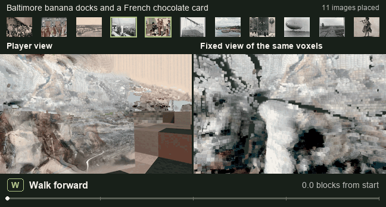

In the second recording, all eleven historical views are already in place. The player walks 18.1 blocks from Baltimore’s banana docks toward a French chocolate card depicting Pasteur, then retraces the route. Watch the fixed camera while the player walks forward and back. The same blocks shift in both directions, with their faces aligned to the world axes. **Replay placement** repeats the arrival of a source. Walking through an established overlap controls the blend with your position. [Enter the recorded overlap](https://jkubiniec.github.io/strata/?demo=walk&complete=1&overlap=1&seed=arcade11)

## Bring your own photos and video

1. Open **My media world** and choose **Import & walk**. Select multiple photos and videos together in the phone library or desktop file picker. Strata prepares them on the device while you explore. JPEG, PNG and HEIC stills are supported. MP4, MOV and WebM playback depends on the browser’s codecs.
2. With cycling on, walk or turn to place the next ready item. On a phone, hold an arrow to walk and drag the scene with your other thumb to aim. Slide across the arrows to change direction and lift to stop. On a computer, use WASD and the mouse.
3. Tap **Stop cycling** to keep exploring the placements already in the world. **Start cycling** resumes from the bank. **G** toggles cycling and **B** places the next item immediately. Video playback has a separate pause control.

Files, placements, edits and playback state are saved in the current browser when storage is available. Private browsing and clearing site data can shorten that lifetime. Available memory and browser storage determine how much media a device can hold.

| Action | Computer |
| --- | --- |
| Walk, sprint, jump | WASD, Shift, Space |
| Aim | Mouse or I/J/K/L |
| Fly, rise, descend | F or double-tap Space to toggle flight, then Space / Q |
| Mine or place a block | Left or right mouse button, or E / R |
| Select material | 1–7 or mouse wheel |
| Place the next bank item / toggle cycling | B / G |
| Place one source / release the pointer | U / Esc |

## How the world is built

**One image.** Strata records the camera position, field of view and direction at placement. Depth Anything V2 Small estimates relative depth. Tiny YOLOv3 supplies object detections and image features. Color and depth samples project along camera rays into world space. At a saved viewpoint, the image also colors any procedural floor or wall that would otherwise hide part of the subject. Nearby faces lose that color first as you step sideways, and blocks you build keep their own materials. Higher-resolution inputs receive a finer sample grid within device limits. The inspector lets you compare the original, estimated depth and detections. The historical atlas ships with these studies precomputed. Personal imports run the models locally. [Depth Anything V2](https://depth-anything-v2.github.io/) · [Joseph Redmon’s Darknet YOLO](https://pjreddie.com/darknet/yolo/)

**Overlapping images.** Feature correspondences give patches in two photographs matching positions. The captured views, their confidence and the player’s position determine the shared geometry. The game moves cube centers and blends colors while keeping the faces orthogonal. **Voxels**, **Splats** and **Hybrid** let you inspect the two representations separately or together. The morph is inspired by latent-space walks. It uses feature matching and spatial interpolation and runs entirely in the browser. [Deep Image Analogy](https://arxiv.org/abs/1705.01088) · [CycleGAN](https://junyanz.github.io/CycleGAN/)

**Moving images.** A video placement retains the original clip for its playback clock and colors. Strata estimates depth on anchor frames, follows matching image patches across sampled frames and interpolates the results at draw time. Phone mode bounds the number of native decoders and the resolution of the depth field. Short, continuous shots preserve more movement detail than long clips with quick cuts. The initial reconstruction supplies the solid surfaces for mining and collisions.

**Beyond the photographed view.** A single photo constrains the visible surfaces best. Layered depth, extrapolated hidden faces and procedural terrain fill gaps as the camera moves. At large viewpoint changes, guessed surfaces and double edges can become visible. Strata streams deterministic 16 × 16-block terrain chunks around the player and restores block edits on return. Flash3D’s multiple depth layers and SHARP’s nearby novel views informed this design. The browser implements its own voxel and splat renderer. [3D Gaussian Splatting](https://repo-sam.inria.fr/fungraph/3d-gaussian-splatting/) · [Flash3D](https://www.robots.ox.ac.uk/~vgg/research/flash3d/) · [SHARP](https://apple-aiml-research.github.io/ml-sharp/)

## Where to take it next

- **Recover a landmark from a short phone orbit.** Estimate the camera positions and shared 3D points across several video frames. A doorway could retain its depth and alignment as you walk around it. [VGGT](https://vgg-t.github.io/)
- **Give the player a say in a morph.** Tap one shape in each of two images to tell the matcher which features should meet. A locomotive wheel could become the moon in the next view.
- **Generate plausible hidden surfaces on a desktop.** Sample several completions behind the visible subject, choose one, and bake it into a portable voxel and splat asset for the phone. [Complete Gaussian Splats](https://nianticspatial.github.io/completesplat/)

## Run locally

Serve the bundled app from the project root and open the local address in a WebGL 2 browser. On macOS, double-clicking **Play Strata.command** also starts it.

```sh
python3 -m http.server 8741 --bind 127.0.0.1 --directory dist
```

The platform menu is at [localhost:8741](http://127.0.0.1:8741/). Run the checks with Node.js 22 or later.

```sh
node --test tests/*.test.mjs
```

Bundled model and runtime licenses are included in the repository. [Vision model notices](dist/vendor/vision/NOTICE.txt) · [HEIC decoder notices and corresponding source](dist/vendor/heif/NOTICE.txt) · [Three.js license](dist/vendor/THREE-LICENSE.txt)
